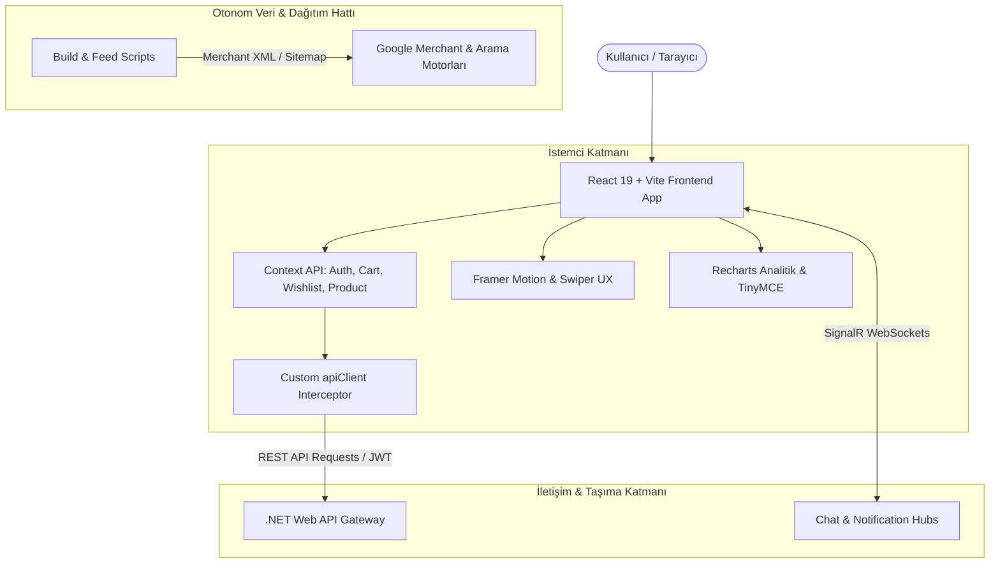

<p align="center">
  
</p>

<h1 align="center">E-Commerce & Product Marketing Engine</h1>

<p align="center">
  <strong>Yüksek Dönüşüm Odaklı, Gerçek Zamanlı ve Ölçeklenebilir Modern Ürün Pazarlama & E-Ticaret Platformu</strong>
</p>

<p align="center">
  
  
  
  
  
  
</p>

---

## 📌 Proje Genel Bakışı

Bu platform; dijital ürün pazarlaması ve modern e-ticaret operasyonlarını en üst düzey kullanıcı deneyimi ve performansla yürütmek üzere tasarlanmış **yeni nesil bir e-ticaret ön yüz (frontend) çözümüdür**.

Kullanıcıların ürün keşfinden sipariş tamamlamaya kadar olan tüm funnel adımlarını kusursuz bir akışla deneyimlemesini sağlarken; arka planda **çift yönlü gerçek zamanlı veri akışı**, **otonom Google Merchant feed üretim hattı**, **sıfır gecikmeli token rotasyonu** ve **güçlü durum yönetimi** ile kurumsal standartlarda bir teknik altyapı sunar.

---

## ⚡ Temel Mimari & Teknik Öne Çıkanlar

### 🔄 1. Eşzamanlılık Korumalı Ağ Katmanı (`apiClient`)
- **Queue Tabanlı JWT Yenileme:** Ağ istekleri 401 aldığında paralel istekleri kuyruğa alarak tek bir `refresh_token` talebiyle çözen ve yarış koşullarını (race-condition) önleyen `subscribeTokenRefresh` mutex mimarisi.
- **Akıllı Oturum Dağıtımı:** Oturum süresi dolduğunda (`dispatchSessionExpired`) özel olaylar (CustomEvent) tetikleyerek UI durumunu kesintisiz güncelleyen reaktif yaklaşım.
- **Dinamik Header Yönetimi:** Misafir alışverişlerini (`x-guest-session-id`) ve `FormData` çok parçalı yüklemelerini otomatik algılayan akıllı istek dönüştürücü.

### ⚡ 2. SignalR ile Canlı Veri & Bildirim Senkronizasyonu
- **Gerçek Zamanlı Destek:** Müşteri ile operasyon ekibi arasında WebSocket üzerinden anlık mesajlaşma (`/hubs/chat`).
- **Anlık Etkinlik Bildirimleri:** Sipariş durumu değişiklikleri, stok uyarıları ve sistem duyuruları için çift yönlü bildirim hattı (`/hubs/notifications`).

### 🛒 3. Kesintisiz Sepet & Misafir Müşteri Mimarisi
- Kullanıcının oturum açma zorunluluğu olmadan sepet ve istek listesi işlemlerini yerel ve sunucu oturumlarıyla eşzamanlayan misafir oturum motoru.
- Çoklu kupon/indirim doğrulama, dinamik kargo hesaplama ve sunucu taraflı güvenli sipariş oluşturma entegrasyonu.

### 📦 4. Otonom SEO & Google Merchant Feed Pipeline
- **Otomatik Merchant XML Üretimi:** Build aşamasında dinamik ürün kataloğunu tarayarak Google Merchant Center standartlarında XML akışı oluşturan `scripts/generate-google-merchant.js`.
- **Otomatik Sitemap & Doğrulama:** Arama motorları için dinamik URL sitemap üretimi ve XML şema geçerliliğini test eden bağımsız doğrulama betikleri (`validate-feed.js`).

### 🛡️ 5. Güvenlik, XSS Koruması & Zengin İçerik
- TinyMCE WYSIWYG editör içeriklerinde **DOMPurify** ile kapsamlı XSS dezenfeksiyonu.
- Hassas işlemler için HTTP-Only Cookie desteği ve XSS/CSRF vektörlerine karşı sıkılaştırılmış doğrulama katmanı.

---

## 🏗️ Sistem Mimarisi



---

## 🛠️ Teknoloji Yığını (Tech Stack)

| Kategori | Teknoloji / Kütüphane | Kullanım Amacı |
| :--- | :--- | :--- |
| **Core Framework** | `React 19`, `Vite 8` | Modern bileşen mimarisi, ultra hızlı HMR ve derleme süreci |
| **Routing** | `React Router 7 / 8` | Gelişmiş istemci taraflı sayfalama ve rol bazlı korumalı rotalar |
| **Real-Time** | `@microsoft/signalr 10` | Çift yönlü WebSocket haberleşmesi (Canlı Sohbet & Bildirimler) |
| **Animasyon & Arayüz** | `Framer Motion 12`, `Swiper 14` | Akıcı mikro-etkileşimler, sayfa geçişleri ve dokunmatik sliderlar |
| **Veri Görselleştirme** | `Recharts 3` | Yönetim paneli sipariş, gelir ve dönüşüm analiz grafikleri |
| **Zengin Metin & Güvenlik** | `TinyMCE`, `DOMPurify` | Güvenli içerik editörü ve tam kapsamlı XSS sanitizasyonu |
| **SEO & Meta Yönetimi** | `react-helmet-async` | Dinamik OpenGraph, Twitter Card ve meta etiket yönetimi |
| **Test Altyapısı** | `Vitest 4`, `MSW 2`, `Testing Library` | Uçtan uca mock servisli 37+ kapsamlı birim & entegrasyon testi |
| **Statik Analiz / Linter** | `Oxlint` | Rust tabanlı, yüksek hızlı statik kod analizi ve kalite denetimi |

---

## 📁 Proje Dizin Yapısı

```bash
isa-proje/
├── public/                 # Statik varlıklar ve manifest dosyaları
├── scripts/                # Otonom feed ve sitemap üretim betikleri
│   ├── generate-google-merchant.js   # Google Merchant Center XML üretici
│   ├── generate-sitemap.js           # Dinamik XML sitemap oluşturucu
│   └── validate-feed.js              # Üretilen XML akışlarını doğrulayıcı
├── src/
│   ├── animations/         # Framer Motion varyantları ve geçiş efektleri
│   ├── api/                # API hata sınıfları ve ortak HTTP yardımcıları
│   ├── auth/               # Token yönetimi ve kimlik doğrulama saklayıcıları
│   ├── components/         # Atomik ve yeniden kullanılabilir UI bileşenleri
│   ├── context/            # Global durum yöneticileri (Auth, Cart, Product, Wishlist, Theme)
│   ├── hooks/              # Özel React hook'ları (API, UI, Sensörler)
│   ├── layouts/            # Ortak sayfa şablonları (Header, Footer, Sidebar)
│   ├── pages/              # Sayfa düzeyindeki bileşenler (Home, Checkout, Admin, Blog, vb.)
│   ├── services/           # Servis soyutlamaları ve REST/SignalR API istemcileri
│   ├── styles/             # Global CSS değişkenleri, tema ve reset tanımları
│   ├── tests/              # 37+ birim ve entegrasyon test süiti
│   └── utils/              # Yardımcı fonksiyonlar (Para birimi, tarih, JWT doğrulama)
├── vite.config.js          # Vite yapılandırma dosyası
└── vitest.config.js        # Vitest test ortamı ayarları
```

---

## 🚀 Hızlı Başlangıç & Kurulum

### Gereksinimler
- **Node.js**: `v18.0.0` veya üzeri
- **npm** veya **yarn** / **pnpm**

### 1. Depoyu Klonlayın ve Bağımlılıkları Yükleyin
```bash
git clone https://github.com/Emrekoc2506/isa_proje.git
cd isa_proje
npm install
```

### 2. Çevre Değişkenlerini Tanımlayın
Kök dizinde `.env` dosyanızı oluşturun:
```env
VITE_API_BASE_URL=https://localhost:7148/api
VITE_SIGNALR_BASE_URL=https://localhost:7148/hubs
VITE_TINYMCE_API_KEY=your_tinymce_key
VITE_META_PIXEL_ID=your_pixel_id
```

### 3. Geliştirme Sunucusunu Başlatın
```bash
npm run dev
```
Uygulama varsayılan olarak **`http://localhost:5173`** portunda çalışacaktır.

---

## 💻 Kullanılabilir Komutlar (NPM Scripts)

| Komut | Açıklama |
| :--- | :--- |
| `npm run dev` | Geliştirme ortamında Vite sunucusunu başlatır. |
| `npm run build` | Merchant feed & sitemap betiklerini çalıştırır ve optimize edilmiş üretim derlemesini (`dist/`) oluşturur. |
| `npm run sitemap` | Güncel ürün ve kategori yollarını tarayarak `sitemap.xml` dosyasını derler. |
| `npm run merchant` | Google Merchant Center uyumlu ürün kataloğu XML beslemesini üretir. |
| `npm run validate:feed` | Üretilen XML beslemelerinin geçerliliğini ve veri bütünlüğünü doğrular. |
| `npm run test` | Vitest ile tüm test süitlerini tek seferde koşar. |
| `npm run test:watch` | Testleri izleme (watch) modunda etkileşimli olarak çalıştırır. |
| `npm run lint` | Rust tabanlı Oxlint ile kod tabanındaki stil ve mantık hatalarını denetler. |

---

## 🧪 Test & Kalite Standartları

Proje, 37'den fazla özel senaryoyu kapsayan kapsamlı bir test mimarisine sahiptir:
- **Güvenlik & Yetkilendirme Testleri:** Token manipülasyonu, oturum süresi aşımı ve rol korumaları.
- **Kupon & Sepet Hesaplama Testleri:** Karmaşık sepet limitleri ve indirim doğrulama testleri.
- **SignalR Entegrasyon Testleri:** Anlık bildirim alma ve sohbet eşzamanlama mock senaryoları.
- **SEO & Feed Bütünlük Testleri:** Merchant çıktılarında XML karakter kaçırma ve HTML entity doğrulamaları.

Testleri çalıştırmak için:
```bash
npm run test
```

---

<p align="center">
  <sub>Modern E-Ticaret ve Dijital Pazarlama Ön Yüz Çözümü • Tüm Hakları Saklıdır.</sub>
</p>
